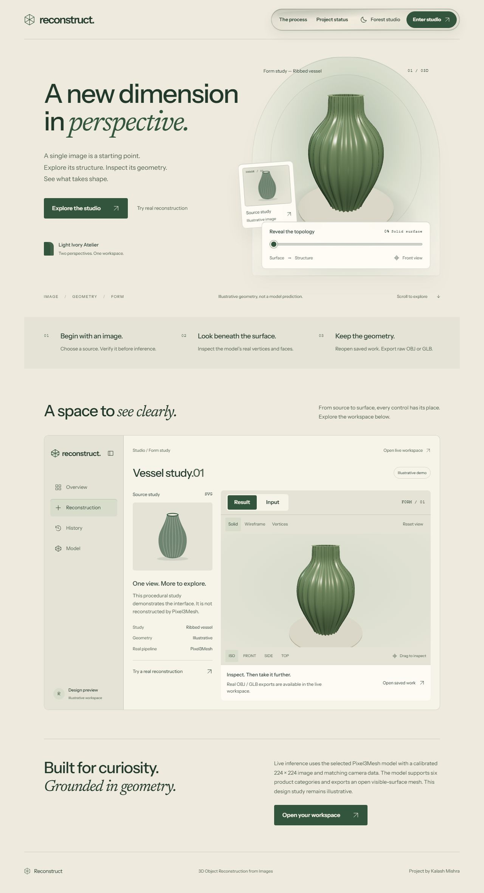
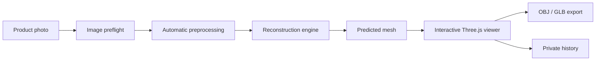

# Pixel3Mesh — Image to 3D Reconstruction

Pixel3Mesh is an interactive research application for exploring approximate 3D representations from a single product photograph. It brings image processing, learned reconstruction, mesh inspection, and private reconstruction history into one web workspace.

[Open the Pixel3Mesh website](https://3d-product-reconstructor.pages.dev/)



## Project overview

Choose a product image, check that it is ready, and request a new 3D reconstruction. The generated colored triangle mesh can be inspected in the browser and exported for further use. A single photograph does not show every surface, so the result is an estimate rather than a complete scan.

## Features

- Single JPEG, PNG, or WebP image upload with drag and drop, preview, and local validation.
- Authenticated preflight checks for image validity, API connectivity, and reconstruction service readiness.
- Automatic foreground preprocessing in the reconstruction service.
- Interactive mesh inspection with Solid, Wireframe, and Vertices modes.
- ISO, Front, Rear, Left, Right, Side, Top, and Bottom camera presets, plus reset, zoom, pan, and fullscreen controls.
- OBJ and GLB export for generated geometry.
- Supabase sign-in and owner-scoped reconstruction history with private artifacts.
- Ivory Atelier and Forest Studio themes.

## Technology

React, Vite, Three.js, FastAPI, PyTorch, Supabase Auth and Storage, Cloudflare Pages, and Modal deployment configuration.

The active single-image inference adapter uses the official pretrained [TripoSR implementation](https://github.com/VAST-AI-Research/TripoSR) and [Stability AI checkpoint](https://huggingface.co/stabilityai/TripoSR). Pixel3Mesh integrates the model; those pretrained weights are not represented as weights trained by this project. The original Pixel2Mesh research code and the separately trained ResNet18-based six-category baseline remain preserved for study.

## Application flow



### Research architecture

The Model Explorer presents the historical Pixel2Mesh graph-based mesh-deformation architecture as research context. It is distinct from the current single-image inference adapter. Historical training source, notebooks, evaluation utilities, and checkpoints are retained in their existing project and Drive locations.

## Getting started

### Requirements

- Node.js 22.18 or later.
- Python 3.11 for the API-only application.
- A configured Supabase project for authentication and private history.
- A separately configured compatible inference worker for live reconstruction.

### Configure and run the API

```powershell
cd backend
py -3.11 -m venv .venv
.venv\Scripts\python.exe -m pip install -e ".[dev]"
Copy-Item .env.example .env.local
.venv\Scripts\python.exe -m app.local_start
```

Set `SUPABASE_URL` and the exact local `CORS_ORIGINS` in the ignored `backend/.env.local`. The API-only service can provide health and image preflight when no model worker is configured; reconstruction then returns an honest unavailable response.

### Configure and run the frontend

```powershell
cd frontend
npm ci
Copy-Item .env.example .env.local
npm run dev -- --host 127.0.0.1 --port 5173
```

Set `VITE_SUPABASE_URL`, `VITE_SUPABASE_ANON_KEY`, and, when the API is hosted separately, `VITE_API_BASE_URL` in the ignored `frontend/.env.local`. The Supabase anon key is intended for browser use; never put a service-role key in frontend configuration. Allow `http://127.0.0.1:5173/auth/callback` in the Supabase Auth redirect list for local development.

For local model inference, configure the verified worker settings documented under `backend/deploy/` and provide the private checkpoint through the approved artifact/cache path. Do not commit model weights, private artifacts, or runtime credentials.

## Deployment status

The public Cloudflare Pages frontend is available at [3d-product-reconstructor.pages.dev](https://3d-product-reconstructor.pages.dev/). Backend and GPU inference deployment must be verified separately before describing live public reconstruction as available. The Modal configuration under `backend/deploy/` is deployment preparation; it does not by itself indicate a running cloud service. The additive history migration is under `supabase/migrations/`; hosted migration and private Storage policy changes require an approved production rollout.

## Future enhancements

### E-commerce browser extension

The proposed extension will let a user request an approximate 3D product representation while browsing an e-commerce listing such as Amazon or Flipkart. It could identify permitted product photographs, start a reconstruction, and show the result in a side panel or embedded viewer with rotation, zoom, and alternate views. This extension is a future enhancement and is not implemented in this repository.

Other possible improvements include reconstruction quality, texture fidelity, inference latency, and broader product coverage.

## Contributing

Pixel3Mesh is open to contributions and further enhancements. Developers, researchers, and contributors interested in computer vision, 3D reconstruction, multimodal AI, and interactive web experiences are welcome to contribute. Contributions that improve reconstruction quality, performance, usability, and future browser-extension integration are particularly encouraged.

Fork the repository, create a focused branch, make and test your change, then open a pull request describing its behavior and verification. Keep credentials, model weights, and private datasets out of commits.

## License and acknowledgments

The repository does not currently include a root-level `LICENSE` file for project code. TripoSR source and pretrained weights retain their upstream license and attribution requirements. Background preprocessing uses U2NETP through [rembg](https://github.com/danielgatis/rembg); retain the applicable upstream notices in redistributed bundles. Do not redistribute model artifacts unless their terms permit it.
