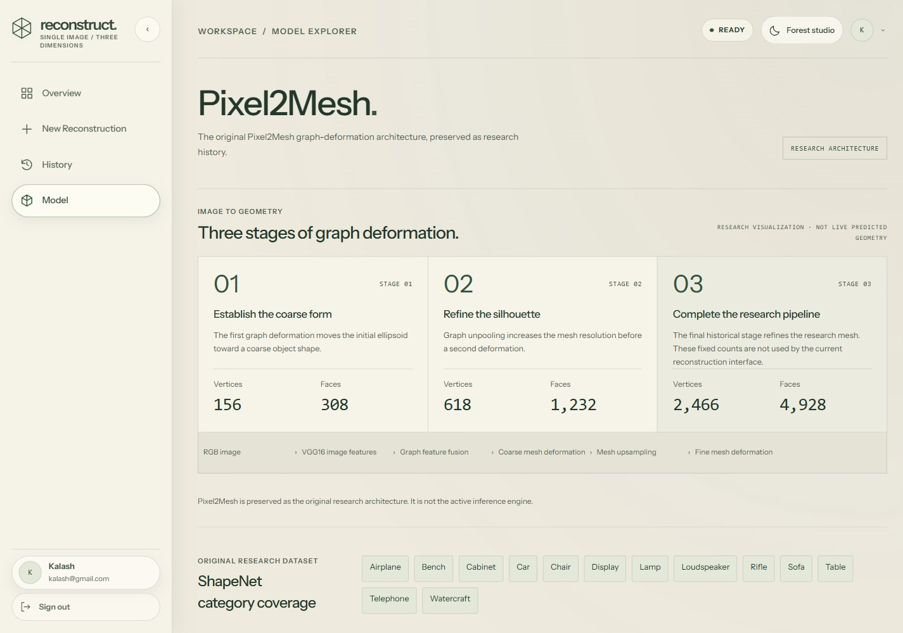

# Pixel3Mesh

Pixel3Mesh is an image-to-3D reconstruction research project with a React, Vite and Three.js frontend, a FastAPI backend, and Supabase authentication and private history. The public frontend is [3d-product-reconstructor.pages.dev](https://3d-product-reconstructor.pages.dev/).

## Application

The reconstruction workspace accepts one JPEG, PNG or WebP image (up to 10 MB), removes its background with U2NETP, and sends it to an authenticated TripoSR inference worker. A successful request returns a colored, variable-size triangle mesh for interactive viewing and OBJ/GLB export. No camera JSON is required. Output is a single-view estimate; hidden surfaces and arbitrary-photo generalization are not guaranteed.

The TripoSR adapter is isolated from the API-only startup path. The API reports liveness separately from inference readiness and rejects inference with HTTP 503 when no compatible worker is configured. The current development demo used an authenticated temporary HTTPS connection to a Colab T4; it is not permanent hosting. Its checkpoint was loaded from the official [stabilityai/TripoSR model](https://huggingface.co/stabilityai/TripoSR), with SHA-256 `429e2c6b22a0923967459de24d67f05962b235f79cde6b032aa7ed2ffcd970ee`. Background removal used U2NETP from [rembg](https://github.com/danielgatis/rembg).

The Model Explorer preserves the original Pixel2Mesh graph-deformation research visualization. It is research history, not the active TripoSR inference architecture.



The custom ResNet18 + 2,048-point decoder and predicted-depth research baseline remains preserved in Google Drive at `MyDrive/Pixel3Mesh_SixCategory_FINAL_20261126/`. Its checkpoint SHA-256 is `ea861cc8f2120d80a8509b2581949445ca8aa73e1d274ba2882ed37e770f3500`. It is not silently substituted for TripoSR inference. Historical training source, data tooling, notebooks and checkpoints remain in their existing locations.

## Authentication and history

Supabase Auth supports email/password and Google sign-in. Reconstruction history stores owner-scoped metadata and private input/OBJ/GLB objects. The additive TripoSR history migration is in `supabase/migrations/20261127180000_triposr_reconstruction_outputs.sql`; it preserves existing records. It passed local PostgreSQL/pgTAP tests but has not been applied to hosted production. Saving TripoSR results to hosted history therefore remains unavailable until that migration and its private Storage policies are approved and applied.

## Local setup

Use Python 3.11 and Node.js 22.18 or later.

1. Install the API-only dependencies:

   ```powershell
   cd backend
   py -3.11 -m venv .venv
   .venv\Scripts\python.exe -m pip install -e ".[dev]"
   ```

2. Create ignored `backend/.env.local` with `SUPABASE_URL` set to the public project URL. This file must not contain a service-role key.

3. Start the API:

   ```powershell
   .venv\Scripts\python.exe -m app.local_start
   ```

4. Create ignored `frontend/.env.local` with `VITE_SUPABASE_URL` and `VITE_SUPABASE_ANON_KEY`. The anon key is public; never use a service-role key in the frontend. Then start the frontend:

   ```powershell
   cd ..\frontend
   npm ci
   npm run dev -- --host 127.0.0.1 --port 5173
   ```

5. Add `http://127.0.0.1:5173/auth/callback` to Supabase Auth's redirect allowlist. Configure `CORS_ORIGINS` for the exact frontend origin. Sign in normally at `/login`.

The worker requires the verified TripoSR bundle, its isolated Python environment, and `TRIPOSR_ROOT`, `TRIPOSR_PYTHON`, `TRIPOSR_CHECKPOINT_SHA256`, and `TRIPOSR_DEVICE`. A temporary remote worker may additionally use `TRIPOSR_REMOTE_URL` (HTTPS only) and `TRIPOSR_REMOTE_TOKEN`. Never commit the token or model weights.

## API

| Method | Endpoint | Purpose |
| --- | --- | --- |
| GET | `/api/v1/health` | API liveness |
| GET | `/api/v1/readiness` | Existing custom-engine readiness |
| GET | `/api/v1/triposr/readiness` | Authenticated TripoSR readiness |
| POST | `/api/v1/triposr/reconstruct` | Authenticated single-image inference; multipart field `image` |
| POST | `/api/v1/reconstructions/preflight` | Existing authenticated image preflight |
| POST | `/api/v1/reconstructions/infer` | Backward-compatible calibrated custom-model route |

## Verification

Executed locally on 27 November 2026:

- Backend: 76 tests passed.
- Frontend: 105 tests passed.
- Vite production build: passed.
- Local Supabase: 72 pgTAP assertions passed across five files, including the additive variable-geometry history and RLS tests. Hosted migration was not applied.
- Authenticated browser flow: real Wikimedia Speaker photograph uploaded through `/reconstruct`; FastAPI returned HTTP 200 from the TripoSR worker; the viewer displayed a new prediction with 57,006 vertices and 114,004 faces; OBJ download was parsed and its indices and coordinates validated.
- Inference provenance: official checkpoint SHA above; the Colab T4 reported 9.96 s model initialization and the live browser request reported 5.49 s inference. The browser test used a temporary tunnel, not a deployed service.
- Ivory Atelier loaded in a fresh browser profile. The screenshot above is a genuine browser capture of the restored Model Explorer.

The public Cloudflare frontend remains on its prior deployment. No public backend, TripoSR service or hosted database migration has been deployed.

## Deployment

The API-only Cloud Run preparation remains under `backend/deploy/`; it does not package TripoSR weights. A GPU inference deployment still needs an approved GCP project, private checkpoint artifact storage, a GPU-capable service configuration, secrets and measured deployment validation. Cloudflare Pages, Supabase and Colab were not changed by this local integration.

## Third-party attribution

TripoSR source and pretrained weights are provided by [VAST-AI-Research/TripoSR](https://github.com/VAST-AI-Research/TripoSR) and [Stability AI](https://huggingface.co/stabilityai/TripoSR) under their published license terms. Background removal uses U2NETP via [rembg](https://github.com/danielgatis/rembg); retain its Apache-2.0 attribution. The TripoSR compatibility package uses a CPU scikit-image marching-cubes adapter; model inference remains on CUDA.
